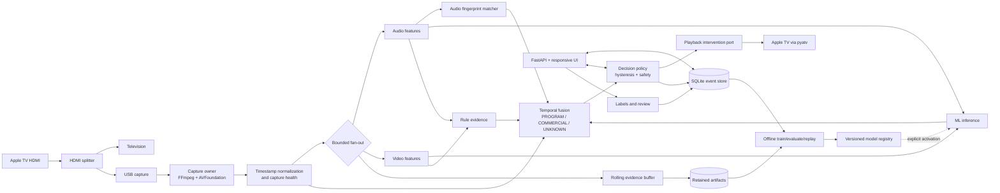

# System architecture

## Goals and constraints

The system optimizes the asymmetric product objective: minimize regular-program
audio muted by mistake, then maximize commercial audio coverage subject to that
safety constraint. It runs locally on a 2015 Intel MacBook Pro with no dedicated
GPU or cloud API. Protected or unavailable content is not worked around; invalid
capture is `UNKNOWN`.

The application is a modular monolith. Components communicate through typed,
timestamped records and bounded in-process channels. CPU-heavy work may move to
a worker process behind the same port, but deployment remains one supervised
application plus the FFmpeg child process.

## Context and data flow



## Runtime topology

### Capture plane

- `CaptureSupervisor` is the only owner of the physical capture endpoints.
- A single FFmpeg process opens both AVFoundation audio and video inputs. It
  emits a timestamp-preserving, two-stream container to the application; a
  decoder produces `AudioChunk` and `VideoFrame` records.
- Timestamps use a monotonic session clock. Original PTS, arrival time, sequence
  number, and discontinuity flags are retained for diagnosis.
- The capture health monitor checks progress, A/V skew, black frames, frozen
  frames, invalid dimensions, audio dropouts, and FFmpeg liveness.
- Fan-out channels have per-consumer capacity and drop policy. Live analysis
  prefers fresh samples; the recorder reports gaps instead of silently losing
  evidence. No slow detector can block device reads.

### Analysis plane

- Audio and video samplers decimate independently from capture rate.
- Feature extractors emit small, versioned vectors rather than model-specific
  decisions.
- Detectors implement the same port and return evidence with validity,
  probabilities, provenance, and an explanation.
- Fingerprinting runs independently from the novel-ad classifier.
- Temporal fusion consumes evidence on a fixed tick, explicitly represents
  missing observations, and returns posterior probabilities for all three
  states.

### Control plane

- `DecisionPolicy` converts temporal state into `NONE`, `MUTE`, or `RESTORE`.
- `InterventionSupervisor` serializes actions, deduplicates desired states,
  monitors connection/capabilities, and owns the failsafe restoration timer.
- Manual override always wins. Pausing detection, unhealthy capture, stale
  inference, application shutdown, or watchdog expiration requests restoration.
- The API/UI observes state through snapshots and event streams; it does not
  reach into detector internals.

### Learning plane

- A rolling in-memory buffer supports event review without default continuous
  recording.
- Configurable retained artifacts are written only around candidate transitions,
  user labels, or explicit recordings.
- Training and evaluation run offline from immutable dataset manifests.
- Model registration and model activation are separate audited operations.

## Proposed repository structure

```text
ad-detect/
├── pyproject.toml                 # core dependencies and tool configuration
├── uv.lock                       # exact cross-platform resolution
├── README.md
├── configs/
│   ├── defaults.toml
│   └── presets.toml
├── docs/
│   ├── adr/                      # one architectural decision per record
│   └── phase-0/
├── src/ad_detect/
│   ├── app.py                    # composition root and lifecycle
│   ├── domain/                   # dependency-free value objects/enums
│   │   ├── capture.py
│   │   ├── evidence.py
│   │   ├── decisions.py
│   │   └── labels.py
│   ├── ports/                    # Protocol/ABC contracts
│   │   ├── capture.py
│   │   ├── detectors.py
│   │   ├── intervention.py
│   │   ├── repositories.py
│   │   └── clock.py
│   ├── capture/
│   │   ├── supervisor.py
│   │   ├── ffmpeg_avfoundation.py
│   │   ├── ffmpeg_v4l2.py
│   │   ├── synchronization.py
│   │   ├── health.py
│   │   ├── fanout.py
│   │   └── simulated.py
│   ├── features/
│   │   ├── audio.py
│   │   ├── video.py
│   │   ├── windows.py
│   │   └── schema.py
│   ├── detectors/
│   │   ├── rules.py
│   │   ├── fingerprint.py
│   │   ├── sklearn_model.py
│   │   └── optional_embeddings.py
│   ├── temporal/
│   │   ├── smoother.py
│   │   ├── hmm.py
│   │   └── fusion.py
│   ├── policy/
│   │   ├── decision.py
│   │   └── watchdog.py
│   ├── intervention/
│   │   ├── supervisor.py
│   │   ├── appletv.py
│   │   └── simulated.py
│   ├── data/
│   │   ├── database.py
│   │   ├── migrations/
│   │   ├── artifacts.py
│   │   ├── retention.py
│   │   └── manifests.py
│   ├── learning/
│   │   ├── split.py
│   │   ├── train.py
│   │   ├── calibrate.py
│   │   ├── evaluate.py
│   │   ├── replay.py
│   │   └── registry.py
│   ├── api/
│   │   ├── routes/
│   │   ├── schemas.py
│   │   ├── auth.py
│   │   └── websocket.py
│   ├── setup/                    # resumable setup state machine
│   ├── config/                   # validated settings and migrations
│   └── observability/            # structured logs and runtime metrics
├── web/                          # TypeScript, minimal build, PWA optional
│   ├── src/
│   └── tests/
├── models/README.md              # metadata only; generated models ignored
├── tests/
│   ├── unit/
│   ├── integration/
│   ├── replay/
│   └── fixtures/
├── scripts/                      # installation and diagnostic entry points
└── var/                          # ignored runtime DB, credentials, clips, models
```

Dependency direction is inward: adapters depend on ports and domain objects;
domain objects do not import FFmpeg, OpenCV, FastAPI, pyatv, or persistence.

## Capture and synchronization

The preferred Phase 2 path is FFmpeg's AVFoundation input because FFmpeg can
select a video and audio device in one input and exposes negotiated formats.
The official device documentation describes both named/indexed device selection
and separate video/audio device indices. The integration must still be verified
against the MS2130, whose macOS presentation may be one muxed device or separate
endpoints.

1. Discovery executes the FFmpeg device-list operation and parses it into stable
   candidates; the wizard stores both display name and a verified signature.
2. A probe negotiates 720p or 1080p at 30 fps and 48 kHz PCM, then records the
   exact accepted mode. Analysis frames are downscaled after capture.
3. The demuxer preserves stream PTS. The synchronizer maps first valid PTS to a
   monotonic session epoch and tracks drift using audio as the dense clock.
4. Windows are joined by time interval, never by "most recent frame". If skew or
   gaps exceed the configured tolerance, the window is invalid and classification
   becomes `UNKNOWN`.
5. FFmpeg stderr and exit status feed health events. Restart uses capped
   exponential backoff and never contributes commercial evidence.

OpenCV remains a video-processing dependency, not the capture owner. A Linux
adapter swaps AVFoundation for V4L2/ALSA while retaining identical records.

## Apple TV control

`AppleTVIntervention` wraps pyatv behind an `InterventionPort`. Discovery,
pairing, connection, feature negotiation, and action execution are separate
operations. The setup wizard pairs supported protocols and uses pyatv's
`FileStorage`; the application places the credential file in a private runtime
directory with user-only permissions and never returns it through the API.

At connection time, `interface.Features` determines whether absolute volume,
step volume, and volume observation are actually available. Preferred behavior:

1. Observe and persist the current volume immediately before muting.
2. If `SetVolume` and volume observation are available, set volume to 0 and later
   restore the observed value only if the session still owns the mute lease.
3. Otherwise use calibrated step-down only in explicit opt-in mode. Count issued
   steps and restore no more than those steps; warn that exact restoration cannot
   be guaranteed.
4. If safe restoration cannot be established, support detection/shadow mode but
   mark automatic mute unavailable.

The supervisor stores `desired_state`, `observed_state`, action generation, mute
lease owner, pre-mute volume, and last acknowledgement. Repeated `MUTE` requests
do not produce repeated commands. Connection loss triggers reconnect with
backoff; a local watchdog attempts restore when possible and surfaces a critical
alert when it cannot confirm restoration.

## Security and privacy boundaries

- Bind to loopback by default. LAN mode requires an explicit enable action,
  authenticated session, CSRF protection, origin checks, and a generated secret.
- State-changing routes require authentication and CSRF even on a trusted LAN.
- Pairing secrets and raw credentials are redacted from logs and API responses.
- Retention is off or minimal by default, separately configurable for audio,
  video thumbnails, feature vectors, and labeled clips.
- Labels are durable. Automatic retention never deletes labeled samples.
- No telemetry or cloud model call is enabled by default.

## Reference-project lessons

[The Clicker](https://github.com/michigandrew/the-clicker) is MIT-licensed and
demonstrates a useful playback-controller seam, macOS device discovery, guided
calibration, shadow mode, dashboard tuning, hysteresis, and safety reset. Its
README also documents the practical HDMI splitter topology and HDCP failure
mode. This design independently reimplements those product patterns.

The new design intentionally changes the core: one synchronized audio/video
capture owner replaces frame polling; versioned evidence replaces detector
globals; `UNKNOWN` is first-class; ML and fingerprinting are independent; and
safe volume restoration replaces fixed asymmetric button counts.

## Primary references

- [The Clicker repository and MIT license](https://github.com/michigandrew/the-clicker)
- [FFmpeg AVFoundation device documentation](https://ffmpeg.org/ffmpeg-devices.html#avfoundation)
- [pyatv concepts and discovery](https://pyatv.dev/documentation/concepts/)
- [pyatv supported-feature guidance](https://pyatv.dev/documentation/supported_features/)
- [pyatv storage and settings](https://pyatv.dev/development/storage/)
- [pyatv audio API](https://pyatv.dev/development/audio/)
