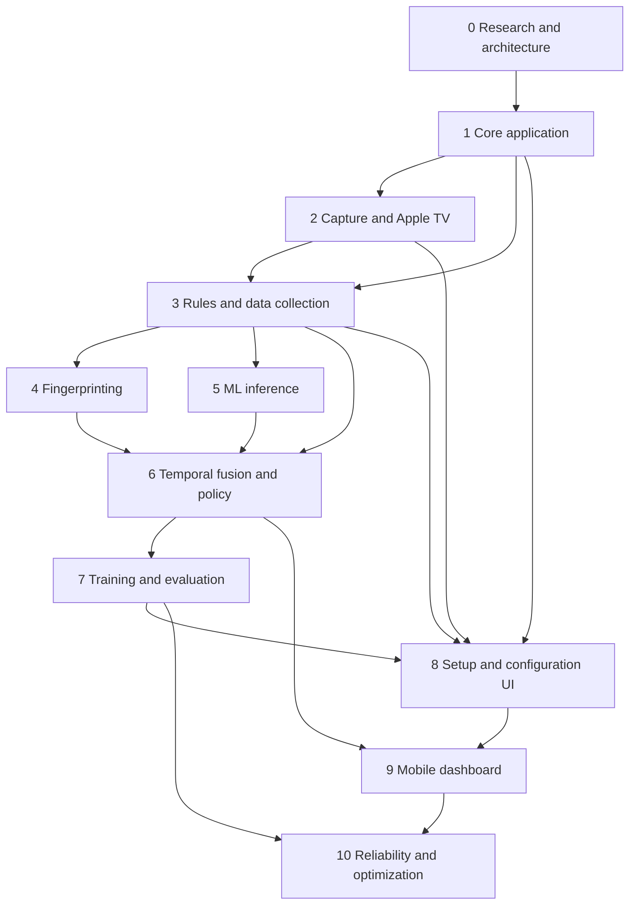

# Implementation roadmap

The order is evidence-driven: establish replayability and safety before adding
model complexity. A phase may start when its explicit dependencies are met;
hardware-independent work can overlap, but acceptance cannot be waived.

## Dependency map

## Phase 0 — Research and architecture

Deliverables:

- architecture, contracts, model/fingerprint/capture research;
- technology decisions, risk register, performance budget;
- dependency-aware roadmap and open-decision log.

Acceptance criteria:

- all ten requested design topics are documented;
- missing capture is explicitly `UNKNOWN` throughout the contracts and policy;
- capture, inference, temporal state, policy, intervention, and learning have
  distinct boundaries;
- unverified hardware/model claims are named as open decisions;
- primary references and reference-project provenance are recorded.

Status: complete as a design package; hardware-dependent decisions remain open.

## Phase 1 — Core application

Depends on: Phase 0.

Scope:

- initialize package, exact dependency groups, lint/type/test tooling;
- domain records and ports from `interfaces.md`;
- validated configuration with revisions and migrations;
- SQLite schema/migrations and artifact manifests;
- FastAPI health/config shell and static responsive shell;
- structured logging, metrics, lifecycle supervision;
- simulated synchronized capture, deterministic clock, and replay fixtures;
- bounded fan-out queues with overflow metrics.

Acceptance criteria:

- clean install and test on macOS Monterey Python 3.11 plus CI Linux;
- a deterministic simulation drives capture -> evidence stub -> temporal stub ->
  shadow decision -> API without real hardware;
- queue overflow, cancellation, shutdown, and stale-data tests pass;
- configuration secrets are excluded from API/log output;
- replaying the same fixture/config produces byte-equivalent decision events
  aside from declared environment metadata.

## Phase 2 — Capture and Apple TV integration

Depends on: Phase 1 and physical hardware access.

Scope:

- FFmpeg/AVFoundation discovery, probe, timestamped A/V capture, health monitor,
  restart supervisor;
- V4L2/ALSA adapter contract stub for portability;
- pyatv discovery, resumable pairing, FileStorage, capability reporting,
  reconnect, idempotent audio-state supervisor, restoration watchdog;
- hardware diagnostics API.

Acceptance criteria:

- target device runs a two-hour capture soak with measured PTS, skew, gaps,
  CPU/RSS, accepted formats, black/frozen/audio-loss detection;
- unplug/replug, FFmpeg crash, black source, missing audio, sleep/wake, and device
  index changes produce reasoned health states and recover or fail safely;
- protected/unavailable capture remains `UNKNOWN` and never creates ad evidence;
- Apple TV discovery/pairing survives application restart without credential
  exposure;
- feature capabilities are reported from pyatv, not assumed;
- mute/restore, repeated requests, manual volume changes, disconnect, and crash
  recovery are tested on the real audio path; if restoration is unsafe, auto
  mode remains disabled and that is an acceptable outcome.

## Phase 3 — Rule baseline and data collection

Depends on: Phase 1; real acceptance also depends on Phase 2 capture.

Scope:

- audio/video classical features and health features;
- rules-only evidence and directional hysteresis baseline;
- rolling buffer and configurable event retention;
- timeline, three-way labels, boundary editing, append-only corrections;
- immutable dataset export and replay runner;
- detection-only and shadow modes.

Acceptance criteria:

- every feature has versioned schema and unit fixtures;
- labeled and unknown spans can be created, corrected, exported, reimported, and
  traced to session/config/device versions;
- disk quota enforcement never deletes labeled data;
- rules baseline replays causally and produces all required metrics, without an
  accuracy claim until representative labels exist;
- capture gaps and queue drops appear as `UNKNOWN`/diagnostic events.

Status: software components and causal replay are implemented; live capture
composition, representative labels, and target-hardware acceptance remain
pending. See [Phase 3 status](../phase-3/README.md).

## Phase 4 — Fingerprinting

Depends on: Phase 3 audio, labels, replay, and artifact persistence.

Scope:

- landmark extraction, hash index, subclip query/alignment;
- reviewed enrollment, duplicate detection, removal/status management;
- query continuity and false-match guards;
- fingerprint-only replay baseline and review UI.

Acceptance criteria:

- arbitrary-position clips from enrolled ads return identity and approximate
  position within a measured tolerance;
- negative program sessions establish false-match behavior and thresholds;
- gain/noise/re-encode tests are reported, not assumed;
- low-information and duplicate samples are rejected or require review;
- only trusted commercial labels can enroll; every entry traces to source span
  and fingerprint version;
- index query meets live latency/resource budget at the measured catalog size.

## Phase 5 — ML inference

Depends on: Phase 3 dataset/replay; meaningful acceptance requires enough labeled
sessions.

Scope:

- multi-window feature aggregation;
- audio, video, and early-fusion scikit-learn candidates;
- calibrated three-class probabilities and model bundles;
- model loader validation and optional embedding benchmark adapters;
- detector ablation reports.

Acceptance criteria:

- preprocessing/model/calibration/schema versions are one immutable bundle;
- grouped training and validation have no session leakage;
- audio, video, and multimodal candidates are compared to rules on unseen
  sessions with confusion matrices and per-session reports;
- probabilities receive calibration diagnostics;
- inference meets budgets and slow/failing optional models cannot block capture;
- optional embeddings enter the default only after clean-install, resource, and
  held-out gain gates pass.

## Phase 6 — Temporal fusion and decision policy

Depends on: Phases 3, 4, and 5 (components may be absent but their interfaces
and missingness behavior must be present).

Scope:

- baseline hysteresis, sliding-window observation model, and three-state HMM;
- evidence deadlines/missingness and explanations;
- separate safety-asymmetric decision policy;
- modes, manual override, break state, mute lease, watchdog, cooldowns.

Acceptance criteria:

- all three temporal approaches run through identical causal replay;
- selected approach measurably improves the declared objective on unseen
  sessions or the simplest baseline is retained;
- invalid/stale capture, expired inference, manual program override, shutdown,
  and maximum duration cannot initiate/renew mute and request restore;
- property/state-machine tests cover command idempotency and all transitions;
- explanations identify evidence contributions and hard gates;
- shadow soak precedes any automatic action.

## Phase 7 — Training and evaluation

Depends on: Phases 3-6.

Scope:

- dataset manifests, grouped split tooling, train/calibrate/evaluate commands;
- causal session replay, resource profiler, full baseline matrix;
- HTML/JSON reports, confusion matrices, boundary/latency plots;
- immutable model registry, activation and rollback audit.

Acceptance criteria:

- required metrics and comparisons are reproducible from manifest + commit +
  config + model hashes;
- reports show aggregate and every-session results, `UNKNOWN`, dropped work, and
  resource use;
- tests demonstrate leakage prevention and final-test immutability;
- registering a model does not activate it;
- activation is explicit, authenticated, audited, reversible, and rejects
  incompatible feature schemas.

## Phase 8 — Guided setup and configuration UI

Depends on: Phases 1-3 and model/registry APIs from Phase 7 where applicable.

Scope:

- resumable setup state machine and eight-step browser workflow;
- Basic/Advanced validated settings and sensitivity profiles;
- capture previews/tests, pairing, calibration, readiness, shadow validation,
  explicit automatic-mute consent;
- diagnostics export with secret redaction.

Acceptance criteria:

- a new user can complete normal setup without editing files or using a CLI;
- refresh/restart resumes safely; hardware/config changes invalidate dependent
  steps only;
- each detector is explained in user language;
- automatic mute cannot enable before readiness, shadow validation, safety
  capability, and explicit consent;
- malformed/unsafe settings are rejected transactionally with actionable errors.

## Phase 9 — Mobile dashboard

Depends on: Phases 6-8.

Scope:

- responsive live status, touch timeline, one-tap labels, manual audio state,
  quick sensitivity, pause/start, mobile calibration;
- authenticated LAN mode, CSRF/origin protection, session management;
- dark mode and optional installable PWA shell.

Acceptance criteria:

- Playwright covers representative phone and desktop viewports;
- primary controls meet accessible touch-target and keyboard/screen-reader needs;
- stale/disconnected UI is obvious and never displays an old state as live;
- all state changes require authenticated, CSRF-protected requests;
- credentials/secrets are never sent to the browser;
- LAN threat review and local-network setup documentation are complete.

## Phase 10 — Reliability and optimization

Depends on: all previous phases and representative hardware/data.

Scope:

- profiling, cadence/model optimization, long-run recovery and retention tests;
- dependency/license/model inventory and reproducible installer;
- fault injection, backup/restore, operational diagnostics and documentation;
- release candidate shadow trial followed by separately consented auto-mute trial.

Acceptance criteria:

- 24-hour soak stays inside accepted CPU/RSS/disk budgets with no unbounded
  queue, thread, descriptor, or database growth;
- failure matrix covers capture loss, FFmpeg exit, model timeout, DB pressure,
  Apple TV disconnect, network changes, sleep/wake, disk full, and process stop;
- watchdog behavior and restoration outcomes are documented for every failure;
- session-held-out evaluation meets the agreed safety gate and reports confidence
  intervals—no training-only claim;
- install/upgrade/rollback/backup recovery are tested on the target OS;
- known limitations, HDCP behavior, privacy defaults, and unsupported volume
  configurations are explicit in release documentation.

## Cross-phase definition of done

Every component change includes typed boundaries, unit tests, integration or
replay tests proportional to risk, structured diagnostics, configuration/schema
migration where needed, and documentation of provenance. Hardware-dependent
features also require a simulator/fake so CI never depends on the living room.

